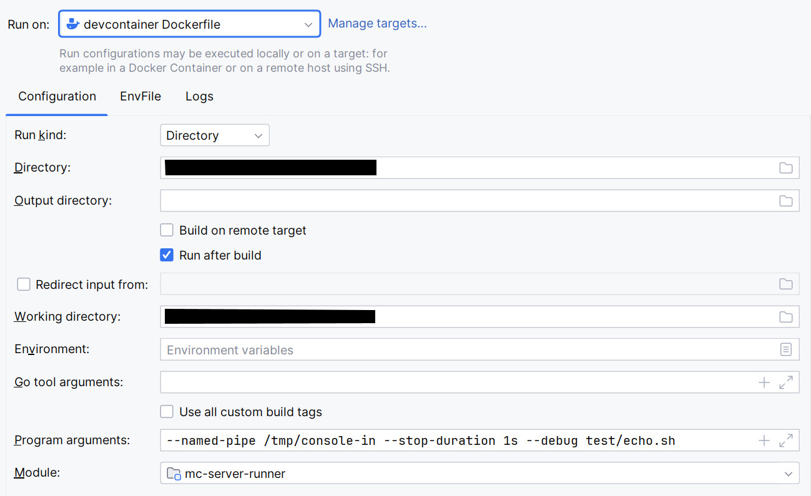
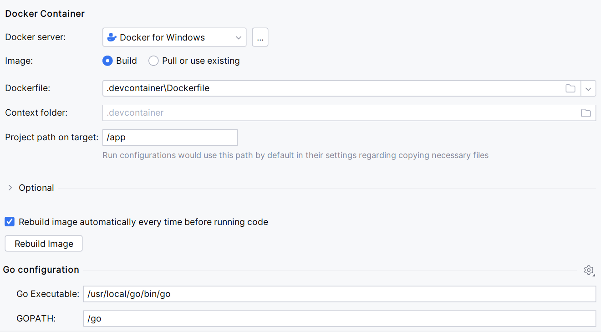

[](https://github.com/itzg/mc-server-runner/releases/latest)
[](https://github.com/itzg/mc-server-runner/actions/workflows/test.yml)


This is a process wrapper used by 
[the itzg/minecraft-server Docker image](https://hub.docker.com/r/itzg/minecraft-server/)
to ensure the Minecraft server is stopped gracefully when the container is sent the `TERM` signal.

## Usage

> Available at any time using `-h`

```
  -bootstrap string
        Specifies a file with commands to initially send to the server
  -debug
        Enable debug logging
  -detach-stdin
        Don't forward stdin and allow process to be put in background
  -named-pipe string
        Optional path to create and read a named pipe for console input
  -remote-console
        Allow remote shell connections over SSH to server console
  -server-host string
        Host of the Minecraft server to query for its status (default "localhost")
  -server-port int
        Port of the Minecraft server to query for its status (default 25565)
  -shell string
        When set, pass the arguments to this shell
  -stop-command string
        Which command to send to the server to stop it (default "stop")
  -stop-duration duration
        Amount of time in Golang duration to wait after sending the 'stop' command.
  -stop-server-announce-delay duration
        Amount of time in Golang duration to wait after announcing server shutdown
  -stop-server-skip-delay-when-empty
        Bypass StopServerAnnounceDelay when the server status reports that no players are online
  -websocket-address string
        Bind address for websocket server (env WEBSOCKET_ADDRESS) (default "0.0.0.0:80")
  -websocket-allowed-origins value
        Comma-separated list of trusted origins (env WEBSOCKET_ALLOWED_ORIGINS)
  -websocket-console
        Allow remote shell over websocket
  -websocket-disable-authentication
        Disable websocket authentication (env WEBSOCKET_DISABLE_AUTHENTICATION)
  -websocket-disable-origin-check
        Disable checking if origin is trusted (env WEBSOCKET_DISABLE_ORIGIN_CHECK)
  -websocket-log-buffer-size int
        Number of log lines to save and send to connecting clients (env WEBSOCKET_LOG_BUFFER_SIZE) (default 50)
  -websocket-password string
        Password will be the same as RCON_PASSWORD if unset (env WEBSOCKET_PASSWORD)
```

The `-stop-server-announce-delay` can by bypassed by sending a `SIGUSR1` signal to the `mc-server-runner` process.  
This works in cases where a prior `SIGTERM` has already been sent **and** in cases where no prior signal has been sent.

With `-stop-server-skip-delay-when-empty` the announcement and delay are also bypassed when nobody is online at the time the `TERM` signal is received.
The player count is obtained by querying the status of the Java edition server at `-server-host` and `-server-port`, the same way a Minecraft client does for its server list.
If that query fails, such as when the server is still starting up, the announcement and delay proceed as usual.

## Development Testing

Start a golang container for building and execution:
> Port 2222 is used for remote ssh console  
Port 80 is used for remote websocket console
```bash
docker run -it --rm \
  -v ${PWD}:/build \
  -w /build \
  -p 2222:2222 \
  -p 80:80 \
  golang:1.19
```

Within that container, build/test by running:

```bash
go run . test/dump.sh
go run . test/bash-only.sh
# Used to test remote console functionality
# Connect to this using an ssh client from outside the container to ensure two-way communication works
go run . -remote-console /usr/bin/sh
# The following should fail
go run . --shell sh test/bash-only.sh
```

### Using the devcontainer's Dockerfile

#### With IntelliJ

Create a "Go Build" run configuration



with a Dockerfile target


